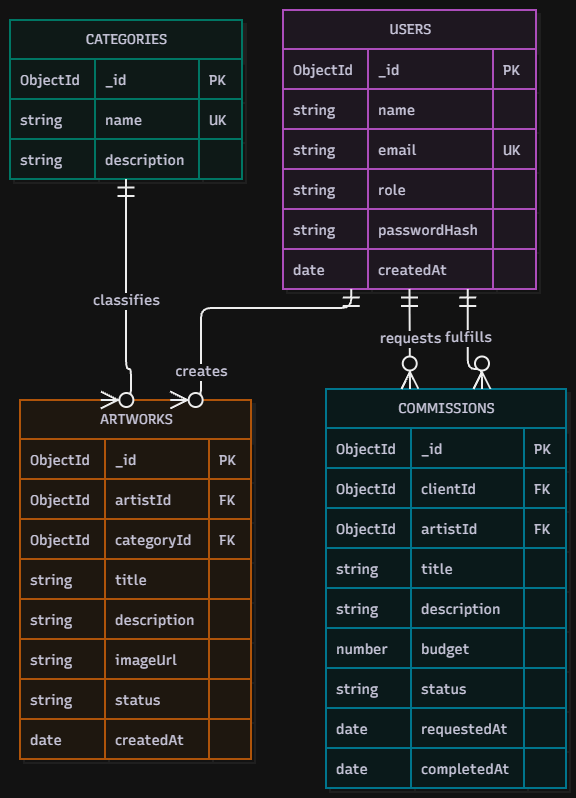

# FINALE PROJECT ---Portafolio ArtSphere

> A centralized, interactive, and high-performance web platform designed for visual artists, designers, and illustrators to showcase their artwork in high resolution and manage custom commission requests without algorithmic distractions.

---

## Project Overview
Publicar y organizar obras artísticas en redes sociales tradicionales suele limitar la presentación visual y la interacción directa. Resuelve este problema ofreciendo un espacio dinámico donde los artistas pueden categorizar sus piezas, mostrar galerías optimizadas en alta resolución, detallar sus procesos creativos y permitir a los clientes solicitar comisiones personalizadas de manera directa.

---

## Technology Stack

| Layer | Technologies |
| :--- | :--- |
| **Frontend** | React.js, HTML5, CSS3, Tailwind CSS, JavaScript (ES6+) |
| **Backend** | Node.js, Express.js (RESTful API Architecture) |
| **Database** | MongoDB / Firebase Firestore |
| **Libraries & Tools** | Axios, React Router, Cloudinary / Firebase Storage, Lucide Icons |

---

## Database Entity-Relationship (MongoDB)
El sistema está estructurado mediante colecciones orientadas a documentos NoSQL:
* **`USERS`**: Almacena perfiles de clientes y del artista administrador (`role`, `email`, contraseña encriptada).
* **`CATEGORIES`**: Clasifica los estilos técnicos del arte (ej. *Digital Illustration*, *Traditional Painting*).
* **`ARTWORKS`**: Contiene las piezas visuales, su enlace multimedia optimizado y detalles del proceso creativo (`artistId`, `categoryId`).
* **`COMMISSIONS`**: Gestiona las solicitudes de encargos personalizados hechas por los clientes (`clientId`, presupuesto, estado del proyecto).

---

## Key Features & User Stories 
- [x] **High-Resolution Gallery:** Exploración de obras de arte adaptadas a una cuadrícula responsiva sin compresión agresiva
- [x] **Dynamic Filtering:** Filtrado rápido de piezas según su categoría o estilo artístico
- [x] **Creative Process Details:** Visualización de bocetos, paletas de colores y notas del autor para cada proyecto
- [x] **Secure Authentication:** Registro e inicio de sesión diferenciado para clientes y administrador
- [x] **Commission System:** Formulario para que los usuarios soliciten proyectos y servicios artísticos personalizados

##  Getting Started & Installation
1. Clonar el repositorio
git clone https://github.com/box1618/Proyecto-final---Portafolio.git

2. Configurar el Backend
cd backend
npm install

Crea un archivo llamado .env en la carpeta del backend con lo siguiente:
PORT=5000
MONGO_URI=tu_conexion_de_mongodb
JWT_SECRET=tu_clave_secreta

Inicia el servidor backend:
npm run dev

3. Configurar el Frontend
cd ../frontend
npm install
npm run dev

## Security & Environment
* Las credenciales de bases de datos y tokens se manejan mediante variables de entorno (.env).
* Las contraseñas de usuario se almacenan de forma segura utilizando hashing (bcrypt).
* Las rutas de administración del portafolio se encuentran protegidas mediante validación de tokens (JWT).

---

## Author
* Fátima Ávila Mendoza — Lead Developer & UI/UX Designer and everything i guess
