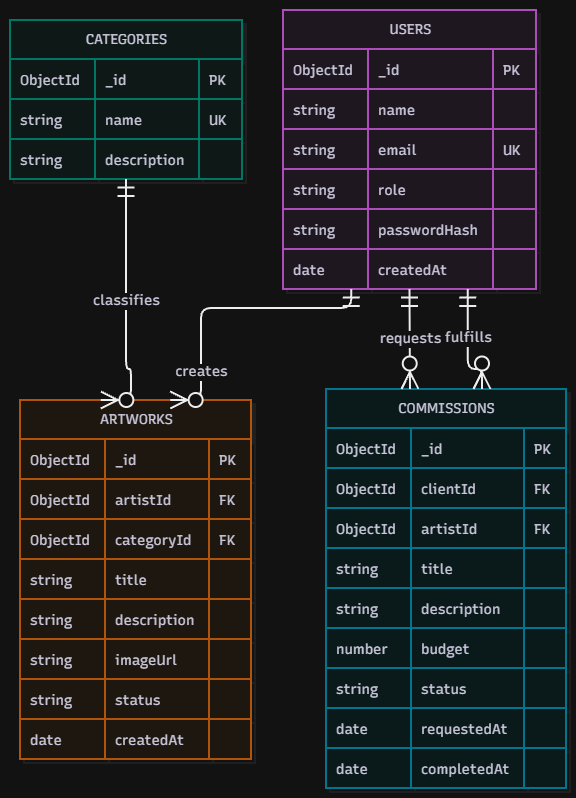

# FINALE PROJECT ---Portafolio ArtSphere

> A centralized, interactive, and high-performance web platform designed for visual artists, designers, and illustrators to showcase their artwork in high resolution and manage custom commission requests without algorithmic distractions.

---

## Project Overview
Publicar y organizar obras artísticas en redes sociales tradicionales suele limitar la presentación visual y la interacción directa. Resuelve este problema ofreciendo un espacio dinámico donde los artistas pueden categorizar sus piezas, mostrar galerías optimizadas en alta resolución, detallar sus procesos creativos y permitir a los clientes solicitar comisiones personalizadas de manera directa.

---

## Technology Stack

| Layer | Technologies |
| :--- | :--- |
| **Frontend** | HTML5, CSS3, JavaScript (ES6+) |
| **Backend** | Node.js, Express.js (RESTful API Architecture) |
| **Database** | MongoDB con Mongoose |
| **Libraries & Tools** | TypeScript, bcrypt, JSON Web Token |

---

## Estructura del Frontend

```text
frontend/
├── index.html
├── css/
│   ├── styles.css
│   ├── client-dashboard.css
│   ├── manage-services.css
│   ├── service-detail.css
│   ├── servicios.css
│   ├── auth.css
│   └── portal-style.css
├── js/
│   ├── auth.js
│   ├── catalog.js
│   ├── client-dashboard.js
│   ├── commission-request.js
│   ├── legacy-service-redirect.js
│   ├── manage-services.js
│   ├── service-detail.js
│   ├── config.js
│   └── services.js
└── pages/
    ├── manage-services.html
    ├── service.html
    ├── client-dashboard.html
    ├── art.html
    ├── animation-art.html
    ├── concept-art.html
    ├── login.html
    ├── portal.html
    ├── portfolio.html
    └── register.html
```

El frontend es estático y vive por completo en `frontend/`. `catalog.js` muestra los servicios publicados desde MongoDB y `manage-services.js` permite administrarlos; `auth.js` conecta el registro/inicio de sesión y `commission-request.js` envía las solicitudes al API. La URL del API para desarrollo se configura en `frontend/js/config.js`.

## Database Entity-Relationship (MongoDB)
El sistema está estructurado mediante colecciones orientadas a documentos NoSQL:
* **`USERS`**: Almacena perfiles de clientes y del artista administrador (`role`, `email`, contraseña encriptada).
* **`CATEGORIES`**: Clasifica los estilos técnicos del arte (ej. *Digital Illustration*, *Traditional Painting*).
* **`ARTWORKS`**: Contiene las piezas visuales, su enlace multimedia optimizado y detalles del proceso creativo (`artistId`, `categoryId`).
* **`SERVICELISTINGS`**: Guarda los servicios publicados, paquetes, precios, reglas, imágenes y estado de publicación. Los paquetes viven dentro de cada servicio porque se consultan y actualizan juntos.
* **`COMMISSIONS`**: Gestiona las solicitudes de encargos personalizados hechas por los clientes (`clientId`, presupuesto, estado del proyecto).

---

## Key Features & User Stories 
- [x] **High-Resolution Gallery:** Exploración de obras de arte adaptadas a una cuadrícula responsiva sin compresión agresiva
- [x] **Dynamic Filtering:** Filtrado rápido de piezas según su categoría o estilo artístico
- [x] **Creative Process Details:** Visualización de bocetos, paletas de colores y notas del autor para cada proyecto
- [x] **Secure Authentication:** Registro e inicio de sesión diferenciado para clientes y administrador
- [x] **Commission System:** Formulario para que los usuarios soliciten proyectos y servicios artísticos personalizados

##  Getting Started & Installation
1. Instala las dependencias desde la raíz del repositorio:

   ```powershell
   npm install
   ```

2. Copia `backend/src/.env.example` como `backend/src/.env` y configura `MONGO_URI` y un `JWT_SECRET` aleatorio de al menos 32 caracteres. `ARTIST_USER_ID` debe ser el ID de la cuenta que tendrá el rol `artist` o `admin`.

3. Registra una cuenta desde el sitio. Para asignarla como artista, cambia su campo `role` a `artist` en MongoDB y copia su `_id` en `ARTIST_USER_ID`. Reinicia el backend después de cambiar el archivo `.env`.

4. Quita los campos profesionales y los valores predeterminados antiguos que versiones anteriores agregaron a clientes. Conserva los usuarios y biografías personalizados:

   ```powershell
   npm run cleanup:client-profile-fields
   ```

   La limpieza solo modifica documentos con `role: "client"`: elimina `artistTitle`/`responseTime` y los valores antiguos predeterminados de `handle` y `bio`.

5. Inicializa los tres servicios de ejemplo en MongoDB (solo agrega los que todavía no existan; no sobrescribe cambios):

   ```powershell
   npm run seed:services
   ```

6. Para subir imágenes, configura `CLOUDINARY_CLOUD_NAME`, `CLOUDINARY_API_KEY` y `CLOUDINARY_API_SECRET` en `backend/src/.env`. Sin esas credenciales el resto del catálogo funciona, pero la subida de imágenes responde con un error explícito.

7. En una terminal inicia el API desde la raíz:

   ```powershell
   npm run dev
   ```

8. En otra terminal sirve el frontend:

   ```powershell
   npm run frontend
   ```

   Abre `http://localhost:5500`. El API queda disponible en `http://localhost:3000`; si usas otro puerto o URL, actualiza `frontend/js/config.js`.

Después de iniciar sesión con rol `artist` o `admin`, usa **Gestionar comisiones** en el perfil para crear, editar o desactivar servicios. Los precios se verifican y calculan en el backend desde el paquete guardado en MongoDB; las órdenes conservan el título, paquete y precio acordados aunque el catálogo cambie después.

Los clientes pueden editar su nombre, usuario (`handle`) y biografía desde **Mi perfil** en `client-dashboard.html`. También pueden subir una foto de perfil, que se almacena en Cloudinary y cuya URL se guarda en el documento de usuario en MongoDB. La edición y la subida requieren una sesión válida de cliente; estos datos no se incluyen en el endpoint de perfil público.

El artista o administrador puede subir su foto y banner desde **Editar perfil** en el perfil principal. Las imágenes se guardan en Cloudinary y MongoDB conserva sus URL en `avatarUrl` y `bannerUrl`, que se muestran en el perfil público. La subida requiere iniciar sesión y tener configuradas las credenciales de Cloudinary en `backend/src/.env`.

### Pruebas y CI

```powershell
npm run build
npm test
```

Las pruebas de integración usan una base MongoDB **dedicada** y vacían solo esa base al iniciar. Para ejecutarlas localmente, inicia una instancia local de MongoDB y define una URI de pruebas:

```powershell
$env:TEST_MONGO_URI = "mongodb://127.0.0.1:27017/artfolio_test"
npm test
```

Para ejecutar también el flujo de navegador registro → inicio de sesión → solicitud de comisión, instala Chromium una vez con `npx playwright install chromium` y ejecuta:

```powershell
$env:E2E_MONGO_URI = "mongodb://127.0.0.1:27017/artfolio_e2e"
npm run test:e2e
```

`npm run test:all` ejecuta las pruebas de API y E2E. Si las URI no están definidas, las pruebas de integración se omiten; CI las configura automáticamente.

Los endpoints incluyen `GET /api/services` y `GET /api/services/:slug` para el catálogo público; `GET /api/services/manage`, `POST /api/services`, `PUT /api/services/:id` y `POST /api/services/images` (solo artista/admin) para gestionarlo; y `POST /api/commissions` (JWT de cliente), `GET /api/commissions` (órdenes propias del cliente, asignadas al artista o todas para admin) y `PATCH /api/commissions/:id/status` (solo artista asignado o admin). GitHub Actions ejecuta compilación, auditoría de dependencias, pruebas de integración y el flujo E2E en cada push y pull request.

Para mostrar la obra de Dibujo renderizado, la página `frontend/pages/art.html` consulta `GET /api/artworks?category=art` y carga la URL de Cloudinary que MongoDB devuelve en `imageUrl`. También se admiten registros existentes sin `category`; las nuevas obras deberían guardar `category: "art"`. El API debe tener conexión a MongoDB y la imagen debe estar disponible públicamente en Cloudinary. Las credenciales de Cloudinary se configuran solo en `backend/src/.env`, nunca en `.env.example` ni en el frontend.

## Security & Environment
* Las credenciales de base de datos, el secreto JWT y el artista asignado se manejan mediante variables de entorno; no subas `backend/src/.env` a Git.
* Las contraseñas se almacenan con bcrypt. El inicio de sesión devuelve un JWT de siete días, que se requiere para enviar una comisión.

---

## Author
* Fátima Ávila Mendoza Lead Developer & UI/UX Designer and everything i guess
